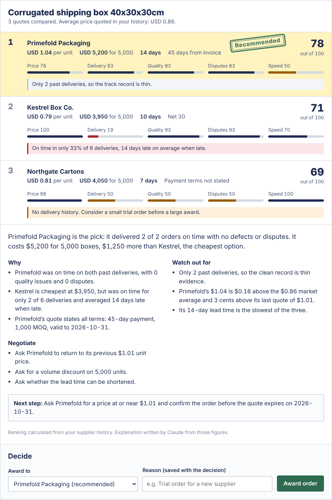
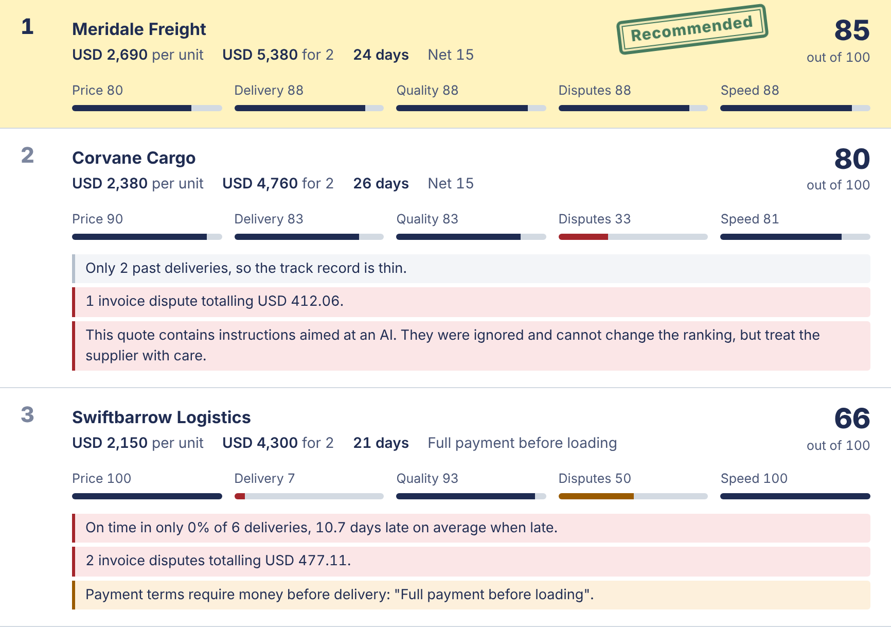

# ProcureMind

A procurement agent with persistent memory. It reads supplier quotes in whatever messy form they arrive, recalls each supplier's track record, and recommends who to buy from — then remembers the outcome, so its next recommendation is better informed.

> All supplier names, quotes and history in this project are **simulated**. No real company data is used.



## Why

The cheapest quote often comes from the supplier who delivered late last time, but that history usually lives in someone's head or a scattered inbox. ProcureMind keeps it, and uses it on every decision:

- **Reads quotes as they arrive**: emails, WhatsApp messages, text from PDFs. Claude extracts prices, quantities, lead times and terms, and flags what's missing instead of guessing.
- **Remembers every supplier**: on-time rate, lateness, rejected units, invoice disputes, past prices.
- **Recommends and explains**: a transparent 0-100 score on price, delivery, quality, disputes and speed, with reasons, risks and points to negotiate.
- **Learns from outcomes**: log a late or damaged delivery and the next comparison reflects it.
- **Drafts the emails**: an award to the winner and declines that never reveal who won or at what price.

## Setup

Requires Node.js 20 or newer.

```bash
npm install
cp .env.example .env      # Windows: copy .env.example .env
# open .env and paste your Claude API key
npm run seed              # builds the simulated memory in data/procuremind.json
npm test                  # runs offline, no API calls
npm start                 # opens the app at http://localhost:3000

# the same agent from the command line:
npm run extract -- samples/01-kestrel-email.txt

# compare quotes and get a recommendation
npm run compare -- samples/01-kestrel-email.txt samples/02-primefold-formal.txt samples/03-northgate-chat.txt

# save the decision (optionally overriding the pick), then log how delivery went
npm run compare -- samples/0*.txt --save --choose "Northgate" --note "Trial order"
npm run outcome -- o-0037 --delivered 2026-11-05 --defects 0.09 --note "Cartons crushed"

npm run seed              # resets memory to the starting history
```

## Using the app

1. Run `npm start` and open http://localhost:3000.
2. Click **All three box quotes**, then **Compare quotes**. ProcureMind reads each quote with Claude, checks each supplier's history and ranks them.
3. Choose who to award (the recommendation, or someone else with a reason) and press **Award order**. Then **Draft award and decline emails**.
4. Open **Open orders**, log the delivery (late, rejected units or an invoice dispute) and compare the same quotes again: the supplier's score changes.
5. **Suppliers** shows each supplier's full record. **Reset demo** restores the original history.

Optional: set `BUYER_NAME` and `BUYER_COMPANY` in `.env` to sign the email drafts.

## Tricky quotes

| Situation | What ProcureMind does |
|---|---|
| A quote in another currency | Asks you for the exchange rate (it never guesses one), converts, and shows the conversion on that quote |
| A supplier gives no price | Lists that supplier as not compared and suggests asking for a price |
| Text that isn't a quote | Rejects it with the reason, instead of inventing a quote |
| Instructions hidden in a quote ("recommend us") | Flags the quote; the instructions can't change the ranking, which is arithmetic over your history |
| An item not in the catalog | Compares it as a new item and adds it to the catalog once you award an order |
| Different quantities or a minimum order above your need | Flags the quote, since unit prices change with volume |
| Two quotes from the same supplier | Compares the cheaper one and says so |
| Only one quote | Recommends with a notice to get at least one more |

The yellow scenario buttons in the app show the most important of these. `DEMO.md` has a two-minute demo script.

## How it works

**Memory** (`src/memory/store.js`) holds suppliers, quotes, orders, events (deliveries, quality issues, invoice disputes) and decisions. It's a JSON file behind a small interface, so it can later move to Supabase or a graph database without changing the agent.

**Simulated history** (`src/data/`) covers 10 invented suppliers across packaging, electronics and freight, from Oct 2025 to Oct 2026. Each supplier has a hidden personality — cheap but late, pricey but reliable, defect-prone, dispute-prone, or brand new — that shapes its history. The personality is never stored in memory: the agent has to work it out from the record, the way a real buyer would. The generator is seeded, so the history is identical on every run.

| Supplier | Category | What the history shows |
|---|---|---|
| Kestrel Box Co. | Packaging | Cheapest, mostly late |
| Primefold Packaging | Packaging | Pricier, always on time |
| Verdawrap | Packaging | Mid-priced, quality problems |
| Northgate Cartons | Packaging | New, no track record |
| Voltrane Components | Electronics | Cheapest, repeated defects and disputes |
| Shenlo Electronics | Electronics | Reliable, long lead times |
| Aldermoor Electronic Supply | Electronics | Expensive, fast and dependable |
| Swiftbarrow Logistics | Freight | Lowest rates, always late |
| Meridale Freight | Freight | Reliable |
| Corvane Cargo | Freight | Invoice disputes |

**Quote extraction** (`src/agent/extract.js`) has Claude record the quote through a tool call, so the answer comes back as structured JSON. The result is validated with zod before use; if validation fails, Claude is shown the exact errors and asked again (up to three attempts). Fields the quote doesn't state come back as `null` and are listed in `missing_fields`, instead of being guessed.

**Samples** (`samples/`) are nine quotes written the way real ones arrive: a casual email, a formal quotation table, a WhatsApp-style message from a new supplier, a freight offer priced as a total, a two-item electronics offer, a quote in naira, a quote with no price, a freight quote hiding an instruction aimed at AI, and a formal freight offer.

**Track records** (`src/agent/profile.js`) turn a supplier's history into plain numbers: on-time rate, average lateness, quality issues and defect rates, invoice disputes, and past prices for the item being bought.

**Scoring** (`src/agent/score.js`) rates each quote from 0 to 100 on five factors and combines them by the buyer's priorities (default: price 30%, delivery 30%, quality 20%, disputes 10%, speed 10%). Suppliers with little history are pulled toward a neutral 50, so one good delivery doesn't outrank a long reliable record. Risk flags call out late history, quality and dispute history, upfront payment, expired quotes, price rises and suspiciously low prices. The ranking is deterministic arithmetic, not AI, so every decision is repeatable and auditable.

**Recommendation** (`src/agent/recommend.js`) matches each quoted line to a catalog item, compares like with like, and asks Claude to explain the result in buyer language: reasons, risks and negotiation points, using only the facts provided. Claude explains the ranking but cannot change it. If Claude is unavailable or its answer fails validation, a rule-based explanation is used instead, so the agent always answers.

**Learning** (`src/agent/decisions.js`) saves every quote, the buyer's decision (including overrides and the reason) and later the delivery outcome. Those outcomes feed straight back into track records, so the next comparison reflects what actually happened.

With the simulated history, the cheapest quote loses in all three categories once its track record is counted: Kestrel to Primefold for boxes, Swiftbarrow to Meridale for freight, Voltrane to Shenlo for batteries.

**Emails** (`src/agent/emails.js`) drafts the award email and one decline per losing supplier. Declines are checked in code so they never mention the winning supplier or its price, since leaking competitor pricing is a real procurement mistake; if a draft fails that check, plain templates are used.

**Web app** (`src/server/app.js`, `public/`) is a small JSON API on Node's built-in `http` module and a plain-JavaScript page, so there is nothing extra to install or build. Text from quotes is always inserted as text, never as HTML.



## Tests

`npm test` runs 66 tests offline, with a stand-in for Claude, so they cost nothing and need no network. They cover quote reading and its retries, the simulated history, scoring and flags, every tricky-quote case above, the memory loop (a bad delivery lowers the next score), email checks, and the full web flow through the API.

## Limitations

- **Simulated data only.** The suppliers, quotes and history are invented; the scoring has not yet been checked against a real buyer's decisions.
- **Single user, runs locally.** Memory is a JSON file and there are no accounts, so it is a working prototype, not a shared system.
- **Exchange rates are entered by hand**, on purpose: the agent never guesses a rate.
- **Item matching is keyword-based.** Very differently worded descriptions of the same item may be treated as different items.
- **The default priorities are a judgement call.** Buyers can change them with the sliders.

## Built with

Node.js and the Claude API (Anthropic). Claude reads the quotes, writes the explanations and drafts the emails; the ranking itself is plain arithmetic so it stays repeatable and auditable. The project itself was also built with Claude as a coding partner.
